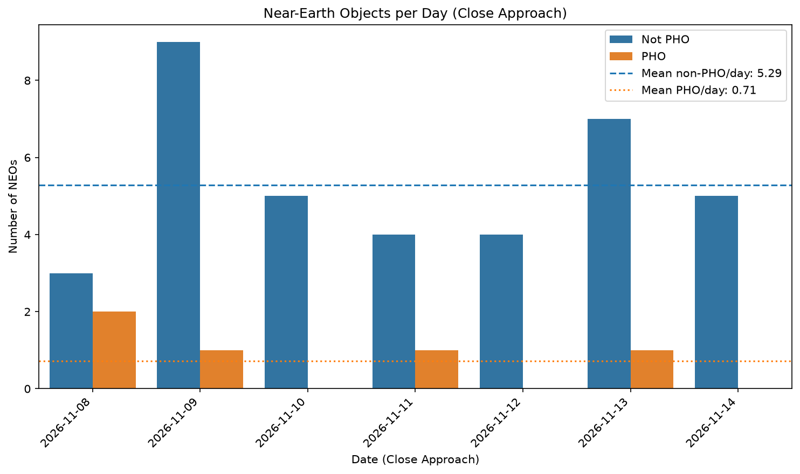

# Tiffany Mui - Module 8 Assignment

Exploration of Potentially Hazardous Objects (PHOs) from NASA's Near-Earth Object Web Service (NeoWs) API (https://api.nasa.gov).

Estimated Minimum:     
Development Environment: Python 3.14.4

## Table of Contents
- [Overview](#overview)
- [Features](#features)
- [Installation](#installation)
- [Usage](#usage)
- [Project Structure](#project-structure)
- [Modules](#modules)
- [Testing](#testing)
- [Author/Credits](#author--credits)

---

## Overview
The NeoWs analysis was created for State University of New York (SUNY): Empire State University (ESU), CSCI-3025: Python Programming course as the Module 8 assignment.

The NeoWs analysis: 
- Pulls JSON data from the feed and lookup endpoints of NASA's NeoWs API.
- Loads JSON data into pandas dataframes
- Trims superfluous data
- Cleans data to ensure that missing values are consistently marked and converts from strings to expected datatypes (e.g. float, int, datetime)
- Copies the dataframe and performs analysis objective trimming (e.g. all unused columns are removed) - this is done per analysis (in the analysis module) and leaves the original data alone
- Performs statistical calculations based on analysis objective - this is done per analysis (in the analysis module)
- Generates charts using matplotlib and seaborn - this is done per analysis (in the analysis module)
- Saves charts to a separate charts folder for clean directories

Ground work for the following features is included, but not fully implemented:
- NeoWs lookup endpoint is fully fleshed out, but main program hard-codes Didymos for this specific analysis
- NeoWs feed endpoint is fully fleshed out, but main program hard-codes analysis dates for consistent analysis
- General API handling with data trimming/cleanup is performed separately than the analysis trimming/cleanup
    - Allows reuse of NeoWs Handle module for other analysis objectives, simply replace the Analysis module and place calls in the main program for it.
    - Trimmed common columns in NeoWs Handle module were conducted for security related (exposing API key), conversions (miles, kilometers), or near duplicate data (close approach date vs. close approach date full)
    - Trimmed lookup data in NeoWs Handle was done for brevity, but ensured enough data points to fully plot the orbit

## Features

- Logging of detailed errors from the API instead of printing those errors to the console
- Robust error handling covering timeouts, HTTP errors, request exceptions, and malformed JSON data with graceful exits when they occur
- Reusable logging module that is file/path agnostic
- All errors are logged with a datetime object
- Reusable ancillary module for general purpose helper and data checking functions
- Analysis agnostic NASA NeoWs API handling module

## Installation

### Prerequisites
- Python 3.11 or higher (estimated)
- External Packages
    - requests - handles http requests and responses
    - python-dotenv - handles loading environment variables
    - pandas - handles data formatting and analysis
    - seaborn - creates graphs
    - matplotlib - handles the underlying settings for graphs
- External APIs
    - NASA NeoWs API from https://api.nasa.gov

### Setup Steps
1. Request an API key from https://api.nasa.gov (a demo key is available, but rates are limited)
2. Download the repository from https://github.com/staramarina/CSCI-3025/tree/main/Module8
3. Verify all files and folders are present
```
   Module8/
    ├── charts                          # Empty directory to hold generated charts
    ├── Mui_Analysis.py                 # Specific analysis functions, including data trimming/cleaning
    ├── Mui_Ancillary.py                # General purpose ancillary tools
    ├── Mui_Logging.py                  # Provides support for generating error/audit logs
    ├── Mui_M8Assignment.py             # Main program
    └── Mui_NeoWsHandle.py              # Handles API calls, environment variables, as well as general data trimming/cleaning
```
4. Install python-dotenv package: (note: it is recommended to utilize a virtual environment to segment dependencies)
```
python -m pip install python-dotenv
```
5. Install requests package:
```
python -m pip install requests
```
6. Install pandas package:
```
python -m pip install pandas
```
7. Install seaborn package: (note: this includes matplotlib installation)
```
python -m pip install seaborn
```
8. Create a .env file within the Module8 directory that includes the following
```
API_KEY = <your_api_key>
```
9. Ensure Python path includes the Module8 directory or run from within it.

## Usage

### Running the Program
From the Module8 directory  
```python Mui_M8Assignment.py```

### Example Interaction
```
Let's explore Near-Earth Objects!

Pulling feed data from 2026-11-08 to 2026-11-14..... Done!
Trimming feed data..... Done!
Cleaning feed data..... Done!
Pulling lookup data on Didymos..... Done!
Trimming Didymos data..... Done!
Cleaning Didymos data..... Done!
Cleaning, analyzing, and plotting PHO vs. non-PHO per day with average statistics..... Done!
Cleaning, analyzing, and plotting miss distance per day with average statistics..... Done!
Cleaning, analyzing, and plotting PHO minimum and maximum diameter per day with Didymos comparison points..... Done!
Cleaning, analyzing, and plotting Didymos orbiting patterns for Earth and Mars with comparison against DART impact..... Done!
Saving PHO vs. non-PHO chart..... Done!
Saving miss distance chart..... Done!
Saving PHO diameter comparison chart..... Done!
Saving Didymos orbit patterns chart..... Done!

All tasks complete!
Charts are located in the charts folder.
```

### Generated Charts

#### PHO vs. non-PHO per Day with Average Statistics


#### Miss distance per Day with Average Statistics


#### PHO Minimum and Maximum Diameter per Day with Didymos Comparison Points


#### Didymos Orbiting Patterns for Earth and Mars with Comparison against DART Impact


## Project Structure
```
   Module8/
    ├── Mui_Analysis.py                 # Specific analysis functions, including data trimming/cleaning
    ├── Mui_Ancillary.py                # General purpose ancillary tools
    ├── Mui_Logging.py                  # Provides support for generating error/audit logs
    ├── Mui_M8Assignment.py             # Main program
    ├── Mui_NeoWsHandle.py              # Handles API calls, environment variables, as well as general data trimming/cleaning
    ├── pyproject.toml                  # Project configuration file
    ├── README.md                       # Read me file (current file)
    ├── charts                          # Directory to hold generated charts
    │     ├── didymos_chart.png         # Chart from Didymos orbiting patterns for Earth and Mars with comparison against DART impact
    │     ├── lun_chart.png             # Chart from miss distance per day with average statistics analysis
    │     ├── neo_chart.png             # Chart from PHO vs. non-PHO per day with average statistics analysis
    │     └── pho_chart.png             # Chart from PHO minimum and maximum diameter per day with Didymos comparison points
    ├── tests                           # Test files for pytest
    │     ├── __init__.py               # Tells Python this is a package
    │     ├── test_analysis.py          # Tests for Mui_Analysis.py
    │     ├── test_ancillary.py         # Tests for Mui_Ancillary.py
    │     └── test_neows.py             # Tests for Mui_NeoWsHandle.py
    └── exampledata                     # Data used for manual tests
          ├── didymos_sampledata.txt    # Real lookup endpoint output data
          ├── feed_sampledata.txt       # Real feed endpoint output data
          └── test_dump.txt             # A dump of the analysis data used for testing purposes
```

## Modules

### Built-in Packages
- sys for graceful program exits
- os to support pathing
- pathlib for paths to call for .env file
- copy to make shallow copies without affecting original instances
- datetime for representing dates

### External Packages
- dotenv for portable handling of environment variables
    - Estimated Minimum: 1.0
    - Development Environment: 1.2.4
- requests for handling API calls
    - Estimated Minimum: 2.31
    - Development Environment: 2.34.2
- pandas for handling large data formatting and analysis
    - Estimated Minimum: 2.0
    - Development Environment: 3.1.1
- seaborn for creating graphs
    - Estimated Minimum: 0.13
    - Development Environment: 0.13.2
- matplotlib for handling graph input
    - Estimated Minimum: 3.7
    - Development Environment: 3.11.2

### Analysis Module (Mui_Analysis.py)
| Function | Purpose | Return |
| ----- | ------ | ------ |
TODO

### Ancillary Module (Mui_Ancillary.py)
| Function | Purpose | Return |
| ----- | ------ | ------ |
TODO

### Logging Module (Mui_Logging.py)
Note: This module is largely unchanged from Module 7, included again here for completness.
| Function | Purpose | Return |
| ----- | ------ | ------ |
TODO

### NeoWs Handle Module (Mui_NeoWsHandle.py)
| Function | Purpose | Return |
| ----- | ------ | ------ |
TODO

## Testing

### Manual Testing
All testing with NASA's NeoWs API was conducted manually to prevent excessive calls to the API. Manual testing included verifying that the API was successfully pulled from environment variables file, the call URL was built correctly, the raw data was successfully received, and the data was successfully inserted into pandas dataframes. A full end-to-end manual test was conducted with various user input to include no input. 

Data output was visually inspected within a file using the following code within the main program to dump the data to a text file. 
```
   with open('exampledata/test_dump.txt', "a") as f:
        f.write(feed_data_clean.to_string(header=True, index=True)) # dumps data from feed endpoint
        f.write('\n\n') # extra lines for readability
        f.write(lookup_data_clean.to_string(header=True, index=True)) # dumps data from lookup endpoint
```

### Automated Testing
Automated testing was conducted with pytest. All API calls are mocked instead of calling the real API, thus all tests can be run with a dummy API key. To run the test, enter the following from within the Module8 directory.
```
python -m pytest
```

#### NeoWs Handle Module Tests (test_neows.py)

##### Testing Fixtures, Variables, and Functions
| Type | Name | Purpose |
| ----- | ------ | ------ |
TODO

##### Testing Classes & Methods
| Class | Method | Purpose |
| ----- | ------ | ------ |

## Author & Credits
Author: Tiffany M. Mui  
Institution: State University of New York: Empire State University  
Course: CSCI-3025 - Python Programming  
Instructor: Dr. Sahand Ziabari  
Date: XX Nov 2026  
