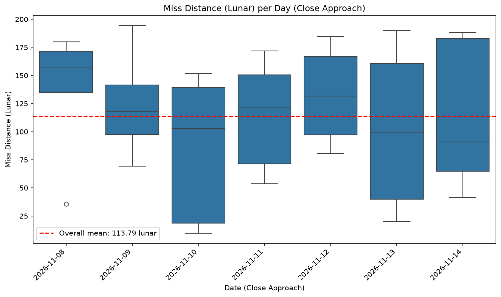
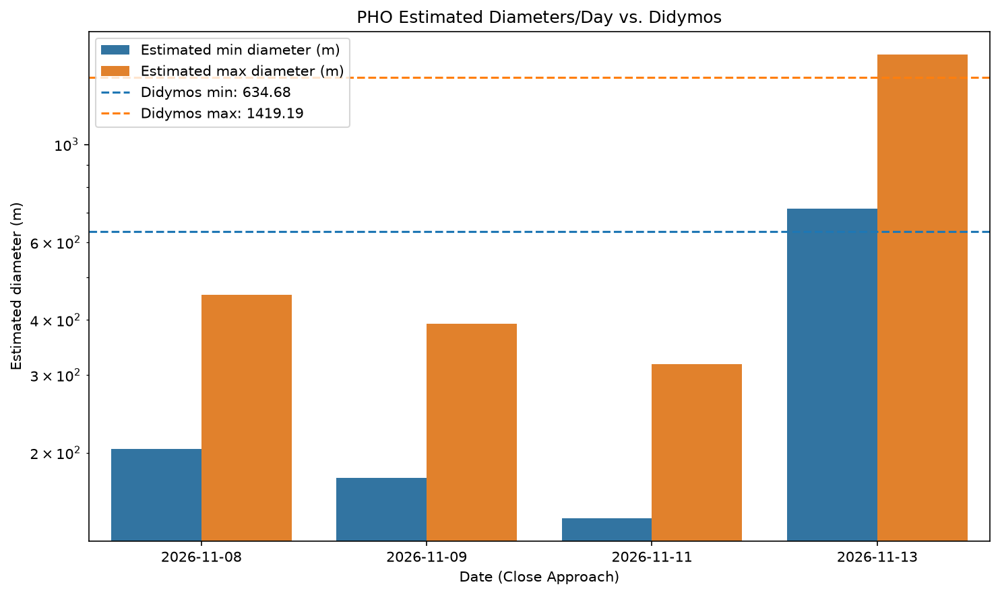

# Tiffany Mui - Module 8 Assignment

Exploration of Potentially Hazardous Objects (PHOs) from NASA's Near-Earth Object Web Service (NeoWs) API (https://api.nasa.gov).

Estimated Minimum:     
Development Environment: Python 3.14.4

## Table of Contents
- [Overview](#overview)
- [Features](#features)
- [Installation](#installation)
- [Usage](#usage)
- [Project Structure](#project-structure)
- [Modules](#modules)
- [Testing](#testing)
- [Author/Credits](#author--credits)

---

## Overview
The NeoWs analysis was created for State University of New York (SUNY): Empire State University (ESU), CSCI-3025: Python Programming course as the Module 8 assignment.

The NeoWs analysis: 
- Pulls JSON data from the feed and lookup endpoints of NASA's NeoWs API.
- Loads JSON data into pandas dataframes
- Trims superfluous data
- Cleans data to ensure that missing values are consistently marked and converts from strings to expected datatypes (e.g. float, int, datetime)
- Copies the dataframe and performs analysis objective trimming (e.g. all unused columns are removed) - this is done per analysis (in the analysis module) and leaves the original data alone
- Performs statistical calculations based on analysis objective - this is done per analysis (in the analysis module)
- Generates charts using matplotlib and seaborn - this is done per analysis (in the analysis module)
- Saves charts to a separate charts folder for clean directories

Ground work for the following features is included, but not fully implemented:
- NeoWs lookup endpoint is fully fleshed out, but main program hard-codes Didymos for this specific analysis
- NeoWs feed endpoint is fully fleshed out, but main program hard-codes analysis dates for consistent analysis
- General API handling with data trimming/cleanup is performed separately than the analysis trimming/cleanup
    - Allows reuse of NeoWs Handle module for other analysis objectives, simply replace the Analysis module and place calls in the main program for it.
    - Trimmed common columns in NeoWs Handle module were conducted for security related (exposing API key), conversions (miles, kilometers), or near duplicate data (close approach date vs. close approach date full)
    - Trimmed lookup data in NeoWs Handle was done for brevity, but ensured enough data points to fully plot the orbit

## Features

- Logging of detailed errors from the API instead of printing those errors to the console
- Robust error handling covering timeouts, HTTP errors, request exceptions, and malformed JSON data with graceful exits when they occur
- Reusable logging module that is file/path agnostic
- All errors are logged with a datetime object
- Reusable ancillary module for general purpose helper and data checking functions
- Analysis agnostic NASA NeoWs API handling module

## Installation

### Prerequisites
- Python 3.11 or higher (estimated)
- External Packages
    - requests - handles http requests and responses
    - python-dotenv - handles loading environment variables
    - pandas - handles data formatting and analysis
    - seaborn - creates graphs
    - matplotlib - handles the underlying settings for graphs
- External APIs
    - NASA NeoWs API from https://api.nasa.gov

### Setup Steps
1. Request an API key from https://api.nasa.gov (a demo key is available, but rates are limited)
2. Download the repository from https://github.com/staramarina/CSCI-3025/tree/main/Module8
3. Verify all files and folders are present
```
   Module8/
    ├── charts                          # Empty directory to hold generated charts
    ├── Mui_Analysis.py                 # Specific analysis functions, including data trimming/cleaning
    ├── Mui_Ancillary.py                # General purpose ancillary tools
    ├── Mui_Logging.py                  # Provides support for generating error/audit logs
    ├── Mui_M8Assignment.py             # Main program
    └── Mui_NeoWsHandle.py              # Handles API calls, environment variables, as well as general data trimming/cleaning
```
4. Install python-dotenv package: (note: it is recommended to utilize a virtual environment to segment dependencies)
```
python -m pip install python-dotenv
```
5. Install requests package:
```
python -m pip install requests
```
6. Install pandas package:
```
python -m pip install pandas
```
7. Install seaborn package: (note: this includes matplotlib installation)
```
python -m pip install seaborn
```
8. Create a .env file within the Module8 directory that includes the following
```
API_KEY = <your_api_key>
```
9. Ensure Python path includes the Module8 directory or run from within it.

## Usage

### Running the Program
From the Module8 directory  
```python Mui_M8Assignment.py```

### Example Interaction
```
Let's explore Near-Earth Objects!

Pulling feed data from 2026-11-08 to 2026-11-14..... Done!
Trimming feed data..... Done!
Cleaning feed data..... Done!
Pulling lookup data on Didymos..... Done!
Trimming Didymos data..... Done!
Cleaning Didymos data..... Done!
Cleaning, analyzing, and plotting PHO vs. non-PHO per day with average statistics..... Done!
Cleaning, analyzing, and plotting miss distance per day with average statistics..... Done!
Cleaning, analyzing, and plotting PHO minimum and maximum diameter per day with Didymos comparison points..... Done!
Cleaning, analyzing, and plotting Didymos orbiting patterns for Earth and Mars with comparison against DART impact..... Done!
Saving PHO vs. non-PHO chart..... Done!
Saving miss distance chart..... Done!
Saving PHO diameter comparison chart..... Done!
Saving Didymos orbit patterns chart..... Done!

All tasks complete!
Charts are located in the charts folder.
```

### Generated Charts & Observations


Based on the chart above, it's clear that there are far more non-Potentially Hazardous Objects (PHOs) per day than PHOs. The mean non-PHOs per day is approximately 5.29, whereas PHOs are about 0.71 per day. While this is a small sample size, it is an interesting look at the distribution. Note that NASA classified PHOs as those that are greater than 140 meters in diameter and their orbit intersection with Earth is less than 19.5 lunar distance apart (NASA JPL, n.d.).




As depicted in the chart above, the distribution of the miss distance, which is the distance between the Earth and the object at the point of flyby, varies significantly per day. The average miss distance per day is approximately 113.79 lunar distance (1 lunar distance is the average distance between the Earth and the Moon). Note flyby distances of Near-Earth Objects (NEOs) can vary, so a NEO that does not pass close to Earth may be closer or further away in the next flyby point in the orbit. 




In the chart above, non-PHOs are explicitly removed from the data set. As such, there are only 4 of the 7 days represented here. The removed dates are those that did not have a PHO included in the data set. Note that the estimated range of Didymos falls within PHOs on 13 Nov 2026, but is far larger than those on the other days. This might suggest that Didymos is a larger object than average, although the data set is too small to definitively confirm this. 


The Didymos binary system includes both Didymos and its moonlet Dimorphos (NASA, n.d.). In 2022, the Double-Asteroid Redirection Test (DART) mission impacted Dimorphos in a test to determine whether the impact could alter the orbital characteristics (JHU APL, n.d.). It was later confirmed that DART not only changed the orbit of Dimorphos around Didymos significantly, it also altered the orbit of Didymos around the Sun (NASA JPL, 2026). From the chart above, a slight change can be observed, especially in the Mars flyby distances that were fairly consistent prior to the impact. Overall, the flyby distance of Didymos to Earth is far more volatile. Additional observation time may be needed to fully understand the long-term impact that the DART mission had. Note: Dimorphos data is not included within the NeoWs data set, only Didymos.


## Project Structure
```
   Module8/
    ├── Mui_Analysis.py                 # Specific analysis functions, including data trimming/cleaning
    ├── Mui_Ancillary.py                # General purpose ancillary tools
    ├── Mui_Logging.py                  # Provides support for generating error/audit logs
    ├── Mui_M8Assignment.py             # Main program
    ├── Mui_NeoWsHandle.py              # Handles API calls, environment variables, as well as general data trimming/cleaning
    ├── pyproject.toml                  # Project configuration file
    ├── README.md                       # Read me file (current file)
    ├── charts                          # Directory to hold generated charts
    │     ├── didymos_chart.png         # Chart from Didymos orbiting patterns for Earth and Mars with comparison against DART impact
    │     ├── lun_chart.png             # Chart from miss distance per day with average statistics analysis
    │     ├── neo_chart.png             # Chart from PHO vs. non-PHO per day with average statistics analysis
    │     └── pho_chart.png             # Chart from PHO minimum and maximum diameter per day with Didymos comparison points
    ├── tests                           # Test files for pytest
    │     ├── __init__.py               # Tells Python this is a package
    │     ├── test_analysis.py          # Tests for Mui_Analysis.py
    │     ├── test_ancillary.py         # Tests for Mui_Ancillary.py
    │     └── test_neows.py             # Tests for Mui_NeoWsHandle.py
    └── exampledata                     # Data used for manual tests
          ├── didymos_sampledata.txt    # Real lookup endpoint output data
          ├── feed_sampledata.txt       # Real feed endpoint output data
          └── test_dump.txt             # A dump of the analysis data used for testing purposes
```

## Modules

### Built-in Packages
- sys for graceful program exits
- os to support pathing
- pathlib for paths to call for .env file
- copy to make shallow copies without affecting original instances
- datetime for representing dates

### External Packages
- dotenv for portable handling of environment variables
    - Estimated Minimum: 1.0
    - Development Environment: 1.2.4
- requests for handling API calls
    - Estimated Minimum: 2.31
    - Development Environment: 2.34.2
- pandas for handling large data formatting and analysis
    - Estimated Minimum: 2.0
    - Development Environment: 3.1.1
- seaborn for creating graphs
    - Estimated Minimum: 0.13
    - Development Environment: 0.13.2
- matplotlib for handling graph input
    - Estimated Minimum: 3.7
    - Development Environment: 3.11.2

### Analysis Module (Mui_Analysis.py)
| Function | Purpose | Return |
| ----- | ------ | ------ |
| neo_pho_trim(data) | Trims data for analysis and plotting of PHO vs. non-PHO per day with comparing averages | trimmed dataframe with only close_approach_date_full and is_potentially_hazardous_asteroid values, with missing values removed |
| neo_avg_calc(trim) | Calculates average PHO statistics | A 3-tuple of the format (average non-PHO, average PHO, average NEO)|
| neo_pho_chart(data) | Generates a clustered column chart of PHO/non-PHO per day with average comparison lines | A 2-tuple of the format (matplotlib figure, matplotlib axes) |
| lun_miss_trim(data) | Trims data for analysis and plotting of lunar miss distance per day with comparing averages | trimmed dataframe with only close_approach_date_full and miss_distance_lunar values, with missing values removed |
| lun_miss_chart(data) | Generates box-and-whisker chart of lunar miss distance per day | A 2-tuple of the format (matplotlib figure, matplotlib axes) |
| pho_size_trim(data) | Trims data for analysis and plotting of min/max diameter of PHO per day with comparison against Didymos | long format trimmed dataframe with min/max and estimated diameter columns of only PHOs with missing values removed |
| pho_size_chart(data, didymos_data) | Generates bar chart of diameters of all PHOs per day, with comparison against Didymos | A 2-tuple of the format (matplotlib figure, matplotlib axes) |
| didymos_orbit_trim(data) | Trims data for analysis and plotting of Didymos orbiting patterns | trimmed dataframe with only close_approach_date_full, miss_distance_lunar, and orbiting_body values, with missing values removed |
| didymos_orbit_chart(data) | Generates a line plot of Didymos miss distance by flyby body | A 2-tuple of the format (matplotlib figure, matplotlib axes) |

### Ancillary Module (Mui_Ancillary.py)
| Function | Purpose | Return |
| ----- | ------ | ------ |
| dtg_check(date_str, format_str) | Determines whether a string can be converted to a datetime object | (True, datetime object) if successful, otherwise (False, error message) |
| chart_save(chart, file_name, dpi=150) | Saves a chart as an image file | A 2-tuple with True/False success flag and additional information |

### Logging Module (Mui_Logging.py)
Note: This module is largely unchanged from Module 7, included again here for completeness.
| Function | Purpose | Return |
| ----- | ------ | ------ |
| can_write_file(file_name) | Checks if a file can be appended | (bool, str) - success flag, message (duplicated from Module5) |
| print_log(data, file_name) | Prints log entries to an existing file (will create if not present) | (bool, str) - success flag, message (duplicated from Module7) |
| err_handle(err_msg, err_log='log.txt') | Handles various errors, prints console message and calls print_log | None (console output) (heavy reuse from Module7) |

### NeoWs Handle Module (Mui_NeoWsHandle.py)
| Function | Purpose | Return |
| ----- | ------ | ------ |
| load_env() | Loads API configuration from environment variables file | The API key stored as environment variable (reused from Module7) |
| build_feed_url(api_key, start, end, err_log="log.txt") | Builds the Neo-Feed query URL | The URL used to query for asteroids based on closest approach date |
| build_lookup_url | Builds the Neo-Lookup query URL | The URL used to query for specific asteroid data |
| neows_call(url, timeout=10, err_log="log.txt") | Calls the NASA NeoWs API | JSON data from the NASA NeoWs API (exits with error and logs) |
| build_dataframe(json_data) | Builds pandas dataframe from nested JSON data | pandas dataframe with close approach and nested dicts flattened |
| trim_common_data(data) | Removes unused columns from feed or lookup dataframe | trimmed feed/lookup data with unused columns removed |
| trim_lookup_data(data) | Removes unused columns that only appear in the lookup dataframe | trimmed lookup data with unused columns removed |
| clean_common_data(data_raw) | Handles common missing or malformed data within a dataframe | feed/lookup data with values in expected formats |
| clean_lookup_data(data_raw) | Handles lookup specific missing or malformed data within a dataframe | lookup data with values in expected formats |

## Testing

### Manual Testing
All testing with NASA's NeoWs API was conducted manually to prevent excessive calls to the API. Manual testing included verifying that the API was successfully pulled from environment variables file, the call URL was built correctly, the raw data was successfully received, and the data was successfully inserted into pandas dataframes. A full end-to-end manual test was conducted and chart generation was inspected. 

Data output was visually inspected within a file using the following code within the main program to dump the data to a text file. This code only existed for testing purposes and was removed after completion.
```
   with open('exampledata/test_dump.txt', "a") as f:
        f.write(feed_data_clean.to_string(header=True, index=True)) # dumps data from feed endpoint
        f.write('\n\n') # extra lines for readability
        f.write(lookup_data_clean.to_string(header=True, index=True)) # dumps data from lookup endpoint
```

### Automated Testing
Automated testing was conducted with pytest. All API calls are mocked instead of calling the real API, thus all tests can be run with a dummy API key, provided it exists within an environment variables file. Note: the logging module (Mui_Logging.py) was copied from Module7 and the only changes include generalizing variable naming and contents within print statement. Thus, it was deemed that there is no need to retest the module.

To run all tests, enter the following from within the Module8 directory.
```
python -m pytest
```

#### Analysis Module Tests (test_analysis.py)

##### Testing Fixtures, Variables, and Functions
| Type | Name | Purpose |
| ----- | ------ | ------ |
| Helper Function | make_common_row(neo_id, date, pho, d_lunar, d_min, d_max, orbit="Earth") | Builds a row that mimics the output of clean_common_data |
| Global Variable | FEED_DATA | Simulates the output data of clean_common_data using real feed endpoint data |
| Global Variable | ORBIT_DATA | Simulates the output data of clean_lookup_data using real lookup endpoint data |
| Global Variable | DIDYMOS_MIN | Didymos minimum estimated diameter |
| Global Variable | DIDYMOS_MAX | Didymos maximum estimated diameter |
| Fixture Function | feed_data() | Returns a pandas dataframe mimicking clean feed data |
| Fixture Function | orbit_data() | Returns a pandas dataframe mimicking clean Didymos data |
| Fixture Function | didymos_diameter() | returns a single-row pandas dataframe for Didymos diameter data |
| Fixture Function | close_plot() | Closes charts after each test |
| Helper Function | hline_label(ax) | Collects labels of reference lines |

##### Testing Classes & Methods
| Class | Method | Purpose |
| ----- | ------ | ------ |
| TestNeoPhoTrim |  | Class to test the neo_pho_trim function |
|  | test_neo_rename(self, feed_data) | Tests that columns are renamed to date and pho_status |
|  | test_neo_orig_change(self, feed_data) | Tests that the original dataframe is unchanged |
|  | test_neo_drop(self, feed_data) | Tests that rows with missing values are dropped |
|  | test_pho_map(self, feed_data) | Tests that PHO boolean is mapped to labels |
|  | test_neo_sort(self, feed_data) | Tests that dates are date objects and sorted |
| TestNeoAvgCalc |  | Class to test the neo_avg_calc function |
|  | test_avg_value(self, feed_data) | Tests that average is calculated correctly |
|  | test_zero_day(self) | Tests that days with no PHOs still count toward average |
| TestNeoPhoChart |  | Class to test the neo_pho_chart function |
|  | test_neo_return_fig(self, feed_data) | Tests that both figure and axes is returned |
|  | test_neo_label(self, feed_data) | Tests that chart title and axis label are correct |
|  | test_neo_avg_label(self, feed_data) | Tests that both average lines are labeled |
| TestLunMissTrim |  | Class to test the lun_miss_trim function |
|  | test_lun_rename(self, feed_data) | Tests that columns are renamed to date and d_miss |
|  | test_lun_orig_change(self, feed_data) | Tests that the original dataframe is unchanged |
|  | test_lun_drop(self, feed_data) | Tests that rows with missing values are dropped |
|  | test_lun_sort(self, feed_data) | Tests that dates are date objects and sorted |
| TestLunMissChart |  | Class to test the lun_miss_chart function |
|  | test_lun_return_fig(self, feed_data) | Tests that both figure and axes is returned |
|  | test_lun_label(self, feed_data) | Tests that chart title and axis label are correct |
|  | test_lun_avg_label(self, feed_data) | Tests that both average lines are labeled |
| TestPhoSizeTrim |  | Class to test the pho_size_trim function |
|  | test_pho_orig_change(self, feed_data) | Tests that the original dataframe is unchanged |
|  | test_pho_drop(self, feed_data) | Tests that rows with missing values are dropped |
|  | test_pho_avg(self, feed_data) | Tests that min and max diameters are averaged per day |
|  | test_pho_long(self, feed_data) | Tests that output is melted to long format |
|  | test_no_pho(self, feed_data) | Tests the case when no PHOs are in the data |
| TestPhoSizeChart |  | Class to test the pho_size_chart function |
|  | test_pho_return_fig(self, feed_data, didymos_diameter) | Tests that both figure and axes is returned |
|  | test_pho_label(self, feed_data, didymos_diameter) | Tests that chart title and axis label are correct |
|  | test_pho_did_label(self, feed_data, didymos_diameter) | Tests that both average lines are labeled |
| TestDidymosOrbitTrim |  | Class to test the didymos_orbit_trim function |
|  | test_did_drop(self, orbit_data) | Tests that rows with missing values are dropped |
|  | test_did_sort(self, orbit_data) | Tests that close_approach_date_full converts to year |
| TestDidymosOrbitChart |  | Class to test the didymos_orbit_chart function |
|  | test_did_return_fig(self, orbit_data) | Tests that both figure and axes is returned |
|  | test_did_label(self, orbit_data) | Tests that chart title and axis label are correct |
|  | test_dart_line(self, orbit_data) | Tests that DART impact line is labeled |
|  | test_did_legend(self, orbit_data) | Tests that both Earth and Mars are in the legend |

#### Ancillary Module Tests (test_ancillary.py)

##### Testing Fixtures, Variables, and Functions
| Type | Name | Purpose |
| ----- | ------ | ------ |
| Helper Function | make_chart() | Returns simple matplotlib (figure, axes) for chart_save tests |
| Fixture Function | close_plot() | Closes charts after each test |

##### Testing Classes & Methods
| Class | Method | Purpose |
| ----- | ------ | ------ |
| TestDateCheck |  | Class to test the dtg_check function |
|  | test_dtg_success(self) | Tests that a datetime object is returned when successful |
|  | test_no_input(self) | Tests that no input returns an error and does not crash |
|  | test_wrong_type(self) | Tests the case of wrong input type |
|  | test_not_date(self) | Tests the case when the date does not exist |
| TestChartSave |  | Class to test the chart_save function |
|  | test_save_success(self, tmp_path) | Tests that a chart was saved successfully |
|  | test_custom_dpi(self, tmp_path) | Tests that a custom dpi is accepted |
|  | test_bad_path(self, tmp_path) | Tests that nonexistent directory returns error |
|  | test_miss_ext(self, tmp_path) | Tests that a file name with missing extension save as .png |

#### NeoWs Handle Module Tests (test_neows.py)

##### Testing Fixtures, Variables, and Functions
| Type | Name | Purpose |
| ----- | ------ | ------ |
| Helper Function | make_cad(date, d_lun, v_kms) | Builds sample close_approach_data |
| Helper Function | make_neo(neo_id, name, cad_ls) | Builds a sample Near-Earth Object entry |
| Global Variable | FEED_JSON | Trimmed down version of real data obtained from the feed endpoint |
| Global Variable | LOOKUP_JSON | Trimmed down version of real data obtained from the lookup endpoint |
| Global Variable | SAMPLE_URL | Truncated version of the real API URL (does not work for true calls) |
| Fixture Function | feed_df() | Returns a dataframe of FEED_JSON |
| Fixture Function | lookup_df() | Returns a dataframe of LOOKUP_JSON |
| Helper Function | make_feed_response(data=None, json_err=None, http_err=None) | Returns a mock response object for requests on the feed endpoint |
| Helper Function | make_lookup_response(data=None, json_err=None, http_err=None) | Returns a mock response object for requests on the lookup endpoint |

##### Testing Classes & Methods
| Class | Method | Purpose |
| ----- | ------ | ------ |
| TestEnvURL |  | Class to test pulling the API key and building the query URLs |
|  | test_pull_key(self) | Tests pulling the API key from the env file |
|  | test_feed_url_good(self) | Tests the successful path of build_feed_url |
|  | test_feed_bad_date(self, tmp_path) | Tests the bad end date path of build_feed_url |
|  | test_lookup_url(self) | Tests that build_lookup_url is successful |
| TestNeoWsSuccess |  | Class to test the successful path in neows_call function |
|  | test_feed_return(self, mock_get) | Tests that a mock call to feed endpoint returns mock feed data |
|  | test_lookup_return(self, mock_get) | Tests that a mock call to feed endpoint returns mock feed data |
|  | test_timeout_default(self, mock_get) | Tests that the timeout is the default if not specified |
|  | test_timeout_specified(self, mock_get) | Tests that the specified timeout is used when given |
| TestNeoWsTimeout |  | Class to test the timeout path in neows_call function |
|  | test_timeout_return(self, mock_get, tmp_path) | Tests that a timeout causes exit with code 1 |
|  | test_timeout_print(self, mock_get, mock_print_log, capsys, tmp_path) | Tests that a timeout is logged and printed error points to logs |
| TestNeoWsHTTP |  | Class to test the HTTP error path in neows_call function |
|  | test_http_none(self, mock_get, tmp_path) | Tests that an HTTP error causes exit with code 1 |
|  | test_http_error(self, mock_get, mock_print_log, capsys, tmp_path) | Tests that HTTP error is logged and printed error points to logs |
| TestNeoWsRequest |  | Class to test the request exception path in neows_call function |
|  | test_connect_none(self, mock_get, mock_log, tmp_path) | Tests that a connection failure causes exit with code 1 |
|  | test_req_err(self, mock_get, mock_print_log, capsys, tmp_path) | Tests that request error is logged and reported |
| TestNeoWsJSON |  | Class to test the value error path in neows_call function |
|  | test_json_none(self, mock_get, tmp_path) | Tests that bad JSON data causes exit with code 1 |
|  | test_json_err(self, mock_get, mock_print_log, capsys, tmp_path) | Tests that bad JSON data error is logged and reported |
| TestBuildDataframe |  | Class to test the build_dataframe function |
|  | test_cad_exploded(self, feed_df) | Test that the cad data exploded results in correct row count |
|  | test_dict_remain(self, feed_df) | Tests that no unflattened dictionaries are present |
|  | test_nested_columns(self, feed_df) | Tests that all nested columns are flattened |
|  | test_lookup_build(self, lookup_df) | Tests that lookup specific rows are included when present |
|  | test_empty_cad(self) | Tests the case when there is no close approach data (edge case) |
| TestTrimData |  | Class to test data trimming functions |
|  | test_common_remove(self, feed_df) | Tests that intended common columns are removed |
|  | test_common_keep(self, feed_df) | Tests that intended common columns are kept |
|  | test_missing_column(self, feed_df) | Tests that missing column error is masked |
|  | test_lookup_remove(self, lookup_df) | Tests that intended specific lookup columns are removed |
|  | test_lookup_keep(self, lookup_df) | Tests that intended specific lookup columns are kept |
| TestCleanData |  | Class to test data cleaning functions |
|  | test_num_convert(self, feed_df) | Tests that numbers in common columns are successfully converted |
|  | test_dtg_convert(self, feed_df) | Tests that date time groups in common columns are converted |
|  | test_bool_map(self, feed_df) | Tests that PHO bool is successfully mapped and converted |
|  | test_duplicates(self) | Tests that duplicate rows are removed |
|  | test_orbit_num(self, lookup_df) | Tests that lookup orbital data is converted to numbers |
|  | test_unique_cad(self, lookup_df) | Tests that unique cad for same ID is kept |

## Author & Credits
Author: Tiffany M. Mui  
Institution: State University of New York: Empire State University  
Course: CSCI-3025 - Python Programming  
Instructor: Dr. Sahand Ziabari  
Date: 20 Nov 2026  

### Tools & AI Use Disclosure
- Black 26.10.1 was utilized to ensure PEP8 compliance. All changes were manually reviewed and approved/disapproved as appropriate. 
- Lumo 2.0 was utilized for syntax and troubleshooting assistance (e.g. "What is the correct pandas syntax to convert string to datetime at the column level?"). Suggestions used were at the individual line level only. Code generation, control flow, module separation, etc. remained under the purview of the author (i.e. at no point were wholesale copy/paste of generated code inserted into this assignment).

### Resources & References
- JHU APL. (n.d.). DART Mission Overview. https://dart.jhuapl.edu/Mission/index.php
- NASA. (n.d.). Didymos and Dimorphos. https://science.nasa.gov/solar-system/asteroids/didymos/
- NASA JPL. (2022). Goldstone Radar Observations Planning: (65803) Didymos & Dimorphos. https://echo.jpl.nasa.gov/asteroids/Didymos/Didymos.2022.planning.html
- NASA JPL. (2026). NASA's DART Mission Changed Orbit of Asteroid Didymos Around Sun. https://www.jpl.nasa.gov/news/nasas-dart-mission-changed-orbit-of-asteroid-didymos-around-sun/
